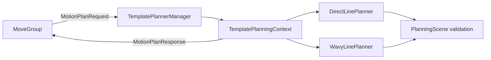

# moveit_plugin_template

This ROS 2 Humble package is a small MoveIt 2 `planning_interface::PlannerManager`
plugin. MoveIt calls the manager to create a per-request
`PlanningContext`; the context delegates trajectory generation to one of the
planners in [`motion_planner_template`](../motion_planner_template).

## Architecture



The supported planner identifiers are `DirectLinePlanner` and
`WavyLinePlanner`. An empty `planner_id` selects `DirectLinePlanner`. The
manager also accepts standard MoveIt planner configuration names, including
`group[PlannerName]`, and passes their `config` map to the selected planner.

## MoveIt configuration

Install this package and select the plugin in the planning pipeline
configuration:

```yaml
planning_pipelines:
  pipeline_names: [template]
  template:
    planning_plugin: moveit_plugin_template/TemplatePlanner
    request_adapters: >-
      default_planner_request_adapters/AddTimeOptimalParameterization
      default_planner_request_adapters/FixWorkspaceBounds
    start_state_max_bounds_error: 0.1

planner_configs:
  DirectLinePlanner:
    num_steps: 100
  WavyLinePlanner:
    num_steps: 100
    amplitude: 0.05
    frequency: 1.0

arm:
  planner_configs: [DirectLinePlanner, WavyLinePlanner]
```

Use `planner_id: WavyLinePlanner` in a `MotionPlanRequest` to select the
wavy planner. The exact YAML nesting can vary with the MoveIt configuration
package; the important values are the plugin name, planner identifiers, and
the planner configuration maps.

## Adding another planner

1. Implement the common interface in `motion_planner_template`.
2. Add the implementation to that package's `CMakeLists.txt`.
3. Include its header in
   [`template_planner_manager.cpp`](src/template_planner_manager.cpp).
4. Add its identifier to `getPlanningAlgorithms()`, `canServiceRequest()`,
   and `makePlanner()` at the marked registration points.
5. Add its planner-specific configuration keys to your `configure()` method
   and to MoveIt's `planner_configs`.

Search for `DirectLinePlanner, WavyLinePlanner` to find the registration
locations. The manager is the only MoveIt integration layer; algorithms should
not implement pluginlib registration themselves.

## Build and dependencies

```bash
source /opt/ros/humble/setup.bash
colcon build --packages-up-to moveit_plugin_template motion_planner_template \
  --event-handlers console_direct+
```

Dependencies are `moveit_core`, `motion_planner_template`, `pluginlib`, and
`rclcpp`.

## License and attribution

Original template code is BSD 3-Clause licensed; see [LICENSE](LICENSE).
The design follows the public MoveIt 2 planner-manager plugin interface used by
MoveIt integrations such as OMPL and CHOMP. No OMPL or CHOMP source is copied;
those projects and MoveIt retain their own licenses and copyrights.
